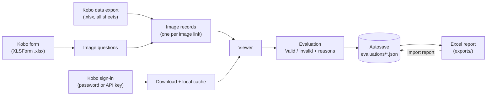

<div align="center">

# Evaluate Kobo Form Images

**Review the quality of images collected with KoboToolbox forms, flag the bad ones and export the evaluation to Excel.**

[](./LICENSE)
[](https://www.python.org/downloads/)
[](https://github.com/jasonCastano/evaluate_kobo_form_images/actions/workflows/ci.yml)
[](https://streamlit.io/)
[](https://github.com/astral-sh/uv)
[](https://github.com/astral-sh/ruff)
[](./.pre-commit-config.yaml)
[](https://conventionalcommits.org)

</div>

---

## 📖 Overview

Field teams collect thousands of photos with [KoboToolbox](https://www.kobotoolbox.org/)
forms. Before those images are used, someone has to check that each one was captured
properly. **Evaluate Kobo Form Images** is a local web app that lets an evaluator:

1. Load a **Kobo form** (XLSForm `.xlsx`) and the **data exported from Kobo** for that form.
2. **Sign in to Kobo** so the private image attachments can be displayed.
3. Look at every collected image with its context and mark it **Valid** or **Invalid** — an
   invalid image needs one or more reasons, plus optional comments.
4. **Save an Excel report** to a local folder that links every evaluation to its form, data
   file, row, submission, question and image.
5. **Resume** later — on another day, computer or by another evaluator — by importing a
   previously exported report.

> 📘 The technical source of truth (stack, rules, architecture and decisions) is
> [`CONSTITUTION.md`](./CONSTITUTION.md). Read it before contributing.

## 📑 Table of contents

- [Overview](#-overview)
- [Features](#-features)
- [How it works](#️-how-it-works)
- [Getting started](#-getting-started)
- [Using the interface](#️-using-the-interface)
- [Kobo account](#-kobo-account)
- [Reports: export and resume](#-reports-export-and-resume)
- [Excel report reference](#-excel-report-reference)
- [Configuration](#️-configuration)
- [Troubleshooting](#-troubleshooting)
- [Quality and automation](#-quality-and-automation)
- [Repository structure](#-repository-structure)
- [Contributing](#-contributing)
- [License](#-license)

## ✨ Features

| Feature | Details |
|---------|---------|
| Any XLSForm | Parses `survey`/`settings`; groups, repeat groups and multilingual labels. |
| Any Kobo export | All sheets; *XML values and headers* or *Labels* headers; group prefixes; duplicate labels resolved in form order. |
| No image lost | Image columns that do not match the form are still listed and flagged. |
| Kobo sign-in | Username & password or API key; the key stays in memory only and is sent only to your Kobo server. |
| Fast image display | EXIF rotation, resizing, local cache and prefetch of the next images. |
| Fast review | Filters by question, status and enumerator; *Save & next*; *Next pending*. |
| Autosave | Every decision is saved immediately; reopening the same form and export continues where you left off. |
| Local report | Excel report saved straight into a folder you choose — never overwritten. |
| Resume from a report | Import a previous report: evaluations are restored and merged (newer wins, nothing deleted) and the viewer jumps to the next pending image. |

## ⚙️ How it works



1. **Inputs.** You provide the XLSForm used in the field and the Excel data export downloaded
   from Kobo for that form. Exports with *XML values and headers* and with *Labels* both work;
   every sheet is read (the main table and one sheet per repeat group).
2. **Finding the images.** In a Kobo export each image question produces a file-name column and
   a `<header>_URL` column with the attachment link. The app matches every `_URL` column to an
   `image` question of the form by its name or by any of its labels (group prefixes, markup and
   letter case are ignored) and creates one **image record** per link. A column that matches no
   question is still listed and a warning is shown, so **no image is silently dropped**.
3. **Showing the images.** Kobo attachments are private: without signing in Kobo answers "not
   found". After you sign in, the app downloads each image with your account's API key, fixes
   its rotation, resizes it for display and keeps a copy in a local cache (`.cache/images`),
   while the next images are fetched in the background.
4. **Evaluating.** For each image you choose *Valid* or *Invalid* (with at least one reason) and
   may add comments. Each image has a stable key built from its submission, sheet, row, question
   and link, so the same image is recognised again in later sessions.
5. **Autosave.** Every saved decision is written immediately to
   `evaluations/<form>__<data export>.json`. Reopening the same form and export restores it.
6. **Report and resume.** The Excel report is written to a local folder. Importing a report
   later restores its evaluations into the autosave, keeping the newest decision for each image.

## 🚀 Getting started

### Prerequisites

- [Python 3.13+](https://www.python.org/downloads/)
- [`uv`](https://docs.astral.sh/uv/getting-started/installation/)
- [Git](https://git-scm.com/); GNU `make` is optional (every `make` command has an alternative below)
- A **KoboToolbox account** with access to the project whose images you will review

### Installation

**Windows (PowerShell):**

```powershell
git clone https://github.com/jasonCastano/evaluate_kobo_form_images.git
cd evaluate_kobo_form_images

$env:UV_PROJECT_ENVIRONMENT = ".venv"   # keep the environment inside the project
uv sync
uv run pre-commit install               # only needed if you will contribute code

Copy-Item .env.example .env             # optional, see Configuration
```

**macOS / Linux, or anywhere with `make`:**

```bash
git clone https://github.com/jasonCastano/evaluate_kobo_form_images.git
cd evaluate_kobo_form_images
make dev                 # uv sync + pre-commit install (uses the project .venv)
cp .env.example .env     # optional
```

> 💡 If your computer defines a global `UV_PROJECT_ENVIRONMENT` variable, `uv` would otherwise
> install the packages into that other environment. `make` always uses the project `.venv`; when
> calling `uv` directly, set `UV_PROJECT_ENVIRONMENT=.venv` first as shown above.

### Start the app

| Platform | Command |
|----------|---------|
| Windows | `.\.venv\Scripts\evaluate-kobo-images.exe` |
| Any (with `make`) | `make run` |
| Any (with `uv`) | `uv run evaluate-kobo-images` |

The app opens in your browser at <http://localhost:8501>. Keep the terminal open while you work;
press `Ctrl+C` in it to stop the app.

## 🖥️ Using the interface

### Screen layout

```text
┌─ Sidebar ───────────────────────┐ ┌─ Main area ─────────────────────────────────────────┐
│ 1. Kobo form                    │ │ 🖼️ Kobo Image Evaluator                              │
│    Form (XLSForm)        [▾]    │ │ Form: <title> (<file>) · Data: <export file>         │
│ 2. Collected data               │ │ Counters: Image questions in form · Images collected │
│    Data export           [▾]    │ │           Valid · Invalid · Pending                  │
│ 3. Kobo account                 │ │ Progress bar: "N of M images evaluated"              │
│    Server [▾]                   │ │ Filters: Questions · Status · Submitted by           │
│    [Username & password|API key]│ │ Navigation: ⏮ First · ◀ Previous · Image # ·         │
│ Evaluator name          [____]  │ │             Next ▶ · Next pending ⏭                  │
│ 4. Report                       │ │ ┌ Image ─────────────┐ ┌ Details + Evaluation ────┐ │
│    Save to folder        [____] │ │ │                    │ │ Question label            │ │
│    💾 Export report             │ │ │      (photo)       │ │ Question name, group, row │ │
│    Previous report (.xlsx)      │ │ │                    │ │ Is the image valid?       │ │
│    ⤴ Import report              │ │ └────────────────────┘ │ reasons · comments · Save │ │
└─────────────────────────────────┘ └─────────────────────────────────────────────────────┘
```

### Step by step

1. **Choose the form** — sidebar **1. Kobo form** → `Form (XLSForm)`. The list shows every
   `.xlsx` inside the `forms/` folder (subfolders included). To use a file from elsewhere choose
   `Upload a file...` and drop it.
2. **Choose the data export** — **2. Collected data** → `Data export`, from the `data/` folder
   or uploaded. It must be the export of the same form. The main area then shows the counters.
   If some image columns do not match the form, a warning lists them (see
   [Troubleshooting](#-troubleshooting)).
3. **Sign in to Kobo** — **3. Kobo account** (details in [Kobo account](#-kobo-account)). Until you
   sign in, the image area shows `Sign in to your Kobo account in the sidebar to see this image.`
4. **Evaluator name** — type your name in `Evaluator name`; it is recorded with every evaluation.
   After signing in it is pre-filled with your Kobo username if empty.
5. **Read the progress** — the counters show the image questions in the form, the images
   collected and how many are `Valid`, `Invalid` and `Pending`; the progress bar shows
   "N of M images evaluated".
6. **Filter** (optional) — `Questions` (one or more image questions), `Status`
   (`All`, `Pending`, `Valid`, `Invalid`) and `Submitted by` (enumerators). The navigation works
   inside the filtered selection; the caption shows "Image N of M in the current selection".
7. **Navigate** — `⏮ First`, `◀ Previous`, `Next ▶`, type a number in `Image #`, or
   `Next pending ⏭` to jump to the next image without an evaluation.
8. **Look at the image** — it is shown large on the left with the link
   `Open original attachment in Kobo` (full resolution in Kobo; requires being logged in to Kobo
   in your browser). On the right you see the question label and the details: question name and
   group, data sheet and row, repeat index, submission ID, submitted by, submission time and image
   file name. `All data of this row` shows every other value of that row of the export (e.g. tree
   codes) to help you judge the image.
9. **Evaluate** — in the **Evaluation** box:
   - `Is the image valid?` → `Valid` or `Invalid`.
   - If **Invalid**, tick at least one reason:
     - `Low lighting`
     - `Too bright / overexposed`
     - `Out of focus / blurry`
     - `Invalid image content` (wrong subject, wrong part of the plant, not the requested photo…)
   - `Additional comments` (optional, free text).
   - Press `💾 Save` to stay on the image or `💾 Save & next` to save and move to the next one.
   - The app refuses incomplete answers with `Select whether the image is valid or invalid.` or
     `Select at least one reason for an invalid image.`
   - A saved image shows "Saved as … by … at … UTC."; `🗑️ Clear this evaluation` removes it.
     Choosing *Valid* ignores any ticked reason.
10. **Export the report and resume later** — sidebar **4. Report**, see
    [Reports: export and resume](#-reports-export-and-resume).

> ✅ Every save is written to disk immediately. You can close the browser or stop the app at any
> time; loading the same form and data export again restores your evaluations.

## 🔐 Kobo account

KoboToolbox keeps image attachments private, so the app needs your Kobo access to display them.

- **Server** — `Global (kf.kobotoolbox.org)`, `EU (eu.kobotoolbox.org)` or `Custom…` (then type the
  `Server URL`, e.g. your organisation's Kobo). It is pre-selected from the image links of the
  loaded export.
- **Tab `Username & password`** — type your Kobo username and password and press `Sign in`. The
  app sends them once to Kobo to obtain your account's API key; the password field is cleared
  immediately and the password is never stored.
- **Tab `API key`** — paste your Kobo API key and press `Sign in`. Use this if you sign in to Kobo
  with your organisation (single sign-on) or with two-factor authentication — such accounts cannot
  use the password tab. In Kobo: *Account settings* → *Security* → *API key*.
- **Automatic sign-in** — if `KOBO_API_TOKEN` is set in the `.env` file, the app signs in on start
  ("via environment").
- **Signed in** — the panel shows `Signed in as <user> on <server>` and how you signed in, plus a
  `Sign out` button. Images you already viewed stay visible after signing out (local cache).
- **Different server warning** — `The images in this export are hosted on <host>.` means you signed
  in to another server than the one hosting the images: sign out and choose the right server.

**Privacy.** The API key is kept only in memory for your browser session and is sent only to the
Kobo server you signed in to (never to any other website). Neither the password nor the key is
written to evaluations, reports, logs or the repository.

## 📤 Reports: export and resume

### Export the report

In sidebar **4. Report**:

1. `Save to folder` — the folder where the report will be written. Default: `exports/` inside the
   project (or `REPORTS_DIR`). You can type any folder, e.g. `D:\reports\civ` or a synced folder;
   it is created if it does not exist.
2. `Include images not evaluated yet` — ticked: one row per image (pending ones too); unticked:
   only evaluated images.
3. Press `💾 Export report`. The message `Report saved to <full path>` confirms the file.

Files are named `image_evaluation__<form>__<YYYYMMDD-HHMMSS>.xlsx`. A report is **never
overwritten**: if the name exists, `-2`, `-3`… is added. If the report cannot be written (invalid
folder, no permission, file open in Excel, slow or offline drive) the app shows
`Could not save the report to <path>: <reason>` and nothing is lost.

### Resume from a previous report

Use this to continue on another day, another computer or with a colleague's report:

1. Load the **same form and data export** the report was made from (sidebar 1 and 2).
2. In **4. Report** → `Previous report (.xlsx)`, select the report file.
3. Press `⤴ Import report`.

The app restores every evaluated row — verdict, reasons, comments, evaluator and date — saves it
immediately to the autosave (so every later report includes it), resets the filters and opens the
**first pending image after the last evaluated image of the report**.

The summary explains what happened:

| Message | Meaning |
|---------|---------|
| `Restored N evaluations from <file> (A added, U updated, K unchanged).` | *added*: images you had not evaluated; *updated*: your evaluation was older than the report's; *unchanged*: identical, or yours was newer or as new |
| `This report was created for form '…' and data '…'. Only matching images were restored.` | The report belongs to another form/export; only images present in the loaded export were restored |
| `N evaluated rows did not match any image in this export.` | Rows whose image is not in the loaded export (different export, or submission deleted) |
| `N rows were rejected` | Rows with an unknown status or reason, *Invalid* without reasons, or an invalid date (expand to see each row) |
| `All images in this export are evaluated.` | Nothing left to review |
| `This report was already imported.` | Same file imported twice in this session — nothing changes |

**Merge rule:** for an image present both locally and in the report, the evaluation with the most
recent date wins (on equal dates your local one is kept). **Nothing is ever deleted**, and
importing the same report twice changes nothing.

> 💾 Tip: keep a copy of `evaluations\*.json` before importing a colleague's report.

## 📊 Excel report reference

| Sheet | Content |
|-------|---------|
| `Evaluations` | One row per image (see columns below); the status cell is coloured green/red/yellow and the image URL is a link. |
| `Summary by question` | Per question: total images, `Valid`, `Invalid`, `Pending` and the count of each reason. |
| `Metadata` | Form file and title, data file, images in the data file, images evaluated, evaluator, generation time (UTC) and app version. |

<details>
<summary><b>Columns of the <code>Evaluations</code> sheet</b></summary>

| Group | Columns |
|-------|---------|
| Source | `Form file`, `Form title`, `Data file`, `Data sheet`, `Data row (Excel)` |
| Submission | `Submission ID`, `Submission UUID`, `Submission time`, `Submitted by`, `Kobo validation status`, `Repeat index`, `Parent table`, `Parent index` |
| Question | `Question name`, `Question label`, `Question group`, `Export column` |
| Image | `Image file name`, `Image URL`, `Image key` |
| Evaluation | `Evaluation status` (`Valid` / `Invalid` / `Pending`), `Reason: Low lighting`, `Reason: Too bright / overexposed`, `Reason: Out of focus / blurry`, `Reason: Invalid image content` (each `Yes` or empty), `Invalid reasons`, `Comments`, `Evaluator`, `Evaluated at (UTC)` |

To re-import an edited report keep at least: `Image key`, `Image URL`, `Question name`,
`Evaluation status`, `Invalid reasons` (or the `Reason: …` columns), `Comments`, `Evaluator` and
`Evaluated at (UTC)`.

</details>

## 🛠️ Configuration

Settings are optional and go in a `.env` file at the project root (copy `.env.example`; `.env` is
never committed).

| Variable | Default | Purpose |
|----------|---------|---------|
| `KOBO_API_TOKEN` | *(empty)* | Kobo API key for automatic sign-in; leave empty to sign in from the sidebar |
| `KOBO_FORMS_DIR` | `forms` | Folder listed in *Form (XLSForm)* |
| `KOBO_DATA_DIR` | `data` | Folder listed in *Data export* |
| `EVALUATIONS_DIR` | `evaluations` | Autosave folder |
| `IMAGE_CACHE_DIR` | `.cache/images` | Downloaded image cache (`make clean-cache` empties it) |
| `REPORTS_DIR` | `exports` | Default *Save to folder* for reports |

Field data never enters Git: `forms/`, `data/`, `evaluations/`, `exports/`, `.cache/`, `*.xlsx` and
`.env` are ignored.

## 🩺 Troubleshooting

| Message / symptom | Cause | What to do |
|-------------------|-------|------------|
| `Sign in to your Kobo account in the sidebar to see this image.` | Kobo attachments are private | Sign in under **3. Kobo account** |
| `Invalid Kobo username or password. …` | Wrong credentials, or an SSO / two-factor account | Check them, or use the `API key` tab |
| `This API key is not valid for <server>.` | Wrong or regenerated key, or wrong server | Copy the key again from Kobo; check the server |
| `Your Kobo access expired or was revoked. Please sign in again.` | The key was regenerated or access changed | Sign in again |
| `Your account does not have access to this image (or it no longer exists in Kobo).` | Your account lacks permission on the project, or the submission was deleted | Ask the project owner for access |
| `Kobo (<server>) cannot be reached. Check your connection and retry.` | No internet or Kobo unavailable | Check the connection and press `Retry` |
| `The images in this export are hosted on <host>.` | Signed in to another server | Sign out and choose the server of the images |
| `Some image columns of the export did not match any image question of the form …` | The form does not match the export (or a different version) | Load the form version used to collect the data; images are still listed |
| `N image(s) have a file name but no URL in the export.` | Kobo did not upload those attachments | Check the submissions in Kobo |
| `Could not save the report to <path>: <reason>` | Invalid folder, no permission, file open in Excel, slow/offline drive | Choose another folder or close the file and retry |
| `This file is not an evaluation report exported by this app.` / `The report is missing required columns: …` | Wrong file or edited report | Use a report exported by the app; keep the required columns |
| `N rows were rejected` / `N evaluated rows did not match any image in this export.` | Edited rows, or a report from another export | Expand the list; load the matching export |
| `uv run` hangs or packages go to another environment | Global `UV_PROJECT_ENVIRONMENT` or no access to PyPI | Use `.\.venv\Scripts\evaluate-kobo-images.exe` or `make run` |

## ✅ Quality and automation

| `make` command | Without `make` (Windows) | Description |
|----------------|--------------------------|-------------|
| `make help` | — | List all targets |
| `make dev` | `uv sync; uv run pre-commit install` | Install the environment and hooks |
| `make run` | `.\.venv\Scripts\evaluate-kobo-images.exe` | Start the app |
| `make check` | `.\.venv\Scripts\python.exe -m ruff check .; .\.venv\Scripts\python.exe -m ty check; .\.venv\Scripts\python.exe -m pytest` | Lint + format check + type check + tests |
| `make lint` / `make format` | `.\.venv\Scripts\python.exe -m ruff check .` / `... -m ruff format .` | Ruff |
| `make test` | `.\.venv\Scripts\python.exe -m pytest` | Tests |
| `make clean-cache` | `Remove-Item -Recurse .cache\images` | Delete the downloaded image cache |

## 📁 Repository structure

```text
evaluate_kobo_form_images/
├── src/evaluate_kobo_form_images/
│   ├── app.py            # Streamlit interface
│   ├── cli.py            # `evaluate-kobo-images` launcher
│   ├── xlsform.py        # XLSForm parser (image questions)
│   ├── kobo_export.py    # Kobo export scanner (one record per image)
│   ├── kobo_auth.py      # Kobo sign-in (password / API key), in-memory session
│   ├── kobo_client.py    # image download (key only to the Kobo server) + cache
│   ├── evaluation.py     # evaluation model, autosave and merge
│   ├── report.py         # Excel report and local saving
│   └── report_import.py  # import a previous report (resume)
├── tests/                # pytest suite (synthetic fixtures only)
├── specs/                # Spec Kit feature specifications (spec, plan, tasks)
├── docs/                 # documentation
├── .github/              # CI, PR and issue templates, labels
├── .claude/ .specify/    # Claude Code + Spec Kit configuration
├── CONSTITUTION.md       # single source of truth
├── Makefile · pyproject.toml · uv.lock
└── (local only, git-ignored) forms/ data/ evaluations/ exports/ .cache/ .env
```

## 🤝 Contributing

See [`CONTRIBUTING.md`](./CONTRIBUTING.md). New features follow the Spec Kit flow
(`/speckit-specify` → `/speckit-plan` → `/speckit-tasks` → `/speckit-implement`, see
[`CLAUDE.md`](./CLAUDE.md)). Branch from `main`, run `make check`, use
[Conventional Commits](https://www.conventionalcommits.org/), open a PR and keep
[`CONSTITUTION.md`](./CONSTITUTION.md) up to date. Commits must be authored by humans only — no
AI/bot co-author trailers.

## 📄 License

Distributed under the [MIT License](./LICENSE).

---

<div align="center">
<sub>Maintained by Jason Alejandro Castaño</sub>
</div>
